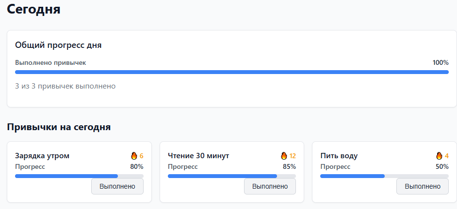
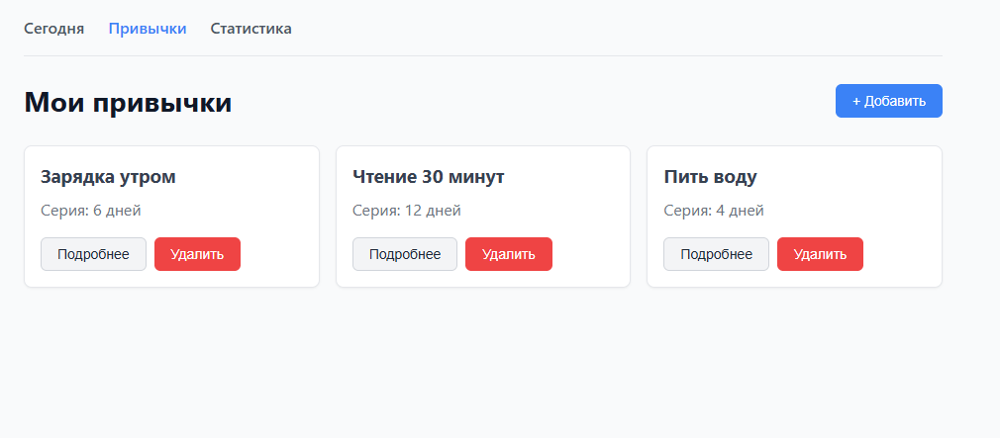
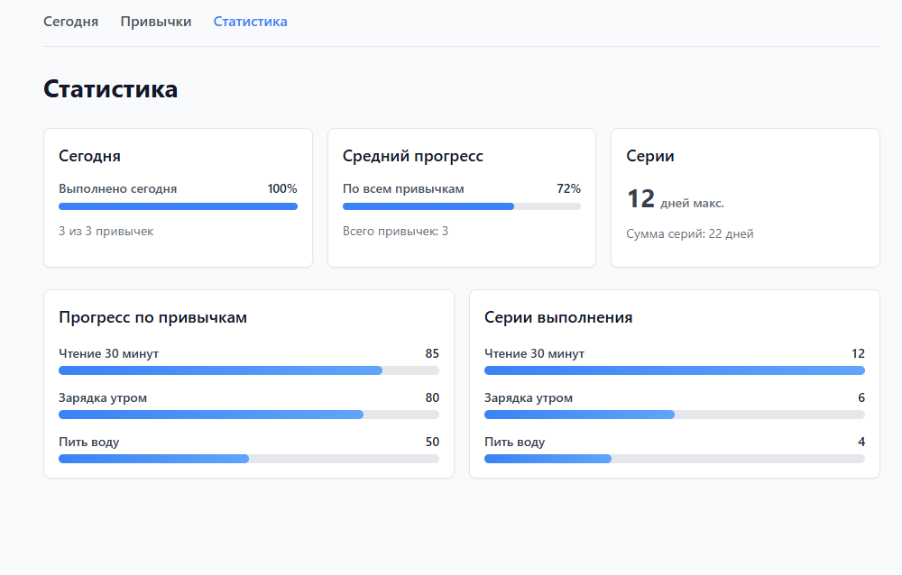

# Habit Tracker

Персональный трекер привычек с визуализацией прогресса и статистикой.

Курсовая работа. Студент №9.

## Описание

Приложение позволяет:
- создавать и управлять привычками;
- отмечать выполнение привычек за день;
- отслеживать прогресс и серии (streak);
- просматривать простую статистику;
- сохранять данные в localStorage (не теряются после перезагрузки).

Проект реализован в виде monorepo:
- `packages/ui` — библиотека общих React-компонентов;
- `packages/app` — основное SPA-приложение.

## Технологии

- TypeScript
- React 18
- Vite
- React Router v6
- Jest + Testing Library
- ESLint 9
- npm workspaces

## Структура

```
packages/
  ui/     — Button, Card, ProgressBar, HabitCard, BarChart
  app/    — страницы и роутинг
```

## Запуск

### Установка зависимостей

```bash
npm install
```

### Режим разработки

```bash
npm run dev
```

Приложение будет доступно по адресу [http://localhost:5173](http://localhost:5173).

### Сборка

```bash
npm run build
```

### Линтинг

```bash
npm run lint
npm run lint:fix
```

### Тесты

```bash
npm run test
npm run test:coverage
```

## Скриншоты

### Главная страница



### Список привычек



### Статистика



## Автор

Студент №9

Лабораторная работа №5
